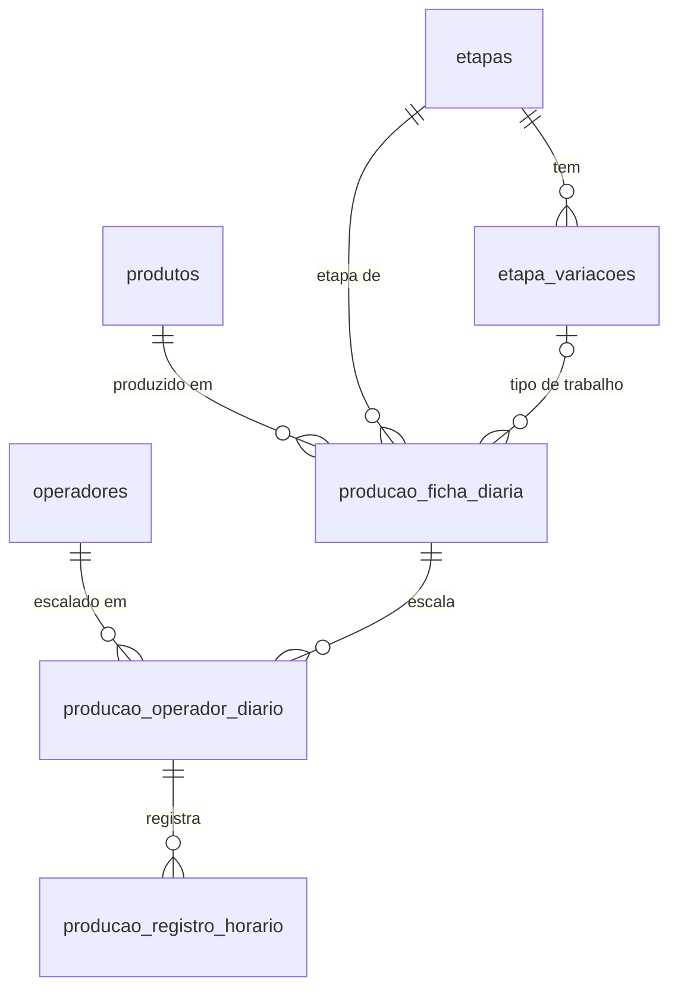

# Banco de dados

SQLite (arquivo `bd_estoque.sqlite` dentro da pasta de dados do app) acessado com **better-sqlite3** e **Drizzle ORM**.
O schema é descrito em TypeScript e evolui por **migrações versionadas**.

## Onde fica

`%APPDATA%\<productName do package.json>\bd_estoque.sqlite`

> O nome da pasta vem do `productName`. Se ele mudar, o app passa a procurar o banco em outra pasta
> e abre "vazio". Não altere o `productName` sem migrar o arquivo.

## Modelo



| Tabela | Papel |
|---|---|
| `operadores` | Cadastro de pessoas (`nome`, `ativo`). Não há login: operador e usuário do sistema são a mesma coisa. |
| `produtos` | `nome`, `descricao`, `versao`, `ativo`. Único por (nome, versão). |
| `etapas` | Etapas do processo (Montagem, Soldagem, Revisão, Gravação...). A ordem de cadastro (`id`) é a ordem exibida. |
| `etapa_variacoes` | Tipos de uma etapa (Soldagem → Cabos, Retrabalho; Gravação → Firmware, IMEI, Serial). Opcional. |
| `producao_ficha_diaria` | Cartão do dia: data + produto + etapa (+ variação). Guarda a meta por hora padrão. |
| `producao_operador_diario` | Operador escalado em uma ficha (com a ordem de exibição). |
| `producao_registro_horario` | Meta e realizado de um operador em uma faixa de horário. |

Regras de integridade que o banco garante (não dependem do código):

- Nomes únicos sem diferenciar maiúsculas (`lower(nome)`), em cada cadastro.
- Uma ficha por data + produto + etapa + variação (dois índices parciais, porque no SQLite `NULL <> NULL`).
- As chaves estrangeiras dos cadastros são `ON DELETE RESTRICT`: o banco recusa apagar um produto/etapa/operador ainda referenciado.
  A exclusão feita pelo app (`remover` nos repositórios) apaga primeiro, em transação, o que depende dele — o produto leva
  seus cartões; a etapa, suas variações e cartões; o operador, suas escalas e registros — e a tela mostra antes
  o impacto (`impacto(id)`). Para só esconder, use `ativo = 0`.
- Apagar uma ficha apaga sua escala e seus registros (`ON DELETE CASCADE`).

As regras de negócio (nome em maiúsculas para operadores, variação pertencer à etapa, não criar ficha com
cadastro inativo...) ficam nos **serviços** (`src/main/services`).

## Camadas (processo principal)

```
controllers/   IPC (canais "operadores:listar", "producao:get-ficha"...)  → traduz para ApiResponse
services/      regras de negócio e validação (lançam ErroNegocio com mensagem para o usuário)
repositories/  consultas Drizzle (nenhuma regra aqui)
models/        db.ts (conexão), schema/ (tabelas), migrador.ts (aplica as migrações)
server/        servidor Express para o gestor (usa os mesmos serviços)
```

## Como alterar o banco (fluxo de migração)

1. Edite o schema em `src/main/models/schema/`.
2. `npm run db:generate -- --name <descricao_curta>` — gera `drizzle/000N_<descricao>.sql` e atualiza `drizzle/meta`.
3. **Leia o SQL gerado.** Se a mudança exige converter dados (ex.: texto → cadastro), edite o `.sql`
   acrescentando os `INSERT/UPDATE` necessários (cada instrução separada por `--> statement-breakpoint`).
4. Adicione/ajuste um teste em `src/main/models/migrador.test.ts` com um banco "antigo" que cubra a conversão.
5. `npm test`.
6. Commite o `.sql`, o `meta/` e o schema juntos.

Regras de ouro:

- **Nunca edite uma migração que já foi publicada.** Crie outra.
- Adicionar coluna `NOT NULL` em tabela com dados: faça em duas migrações (adiciona opcional → preenche → torna obrigatória).
- Reconstruir tabela (DROP + RENAME) exige as chaves estrangeiras desligadas; o `migrador` já faz isso, e confere
  `PRAGMA foreign_key_check` ao final. Sem isso, o `DROP` de uma tabela "pai" apaga os filhos em cascata.

## O que acontece ao abrir o app

`migrarBanco` (em `src/main.ts`, antes de registrar qualquer canal IPC):

1. Compara as migrações do pacote com as já aplicadas (`__drizzle_migrations`).
2. Se há pendência **e o banco já tem dados**: confere duplicidades que a conversão juntaria e faz uma
   cópia de segurança em `<pasta de dados>\backups\bd_estoque-antes-da-migracao-<data>.sqlite` (mantém as 5 últimas).
3. Aplica as migrações dentro de uma transação. Se falhar, nada é alterado, o app mostra o erro e fecha.

## Testes

```
npm test           # roda uma vez
npm run test:watch
```

Os testes usam SQLite em memória criado pelas próprias migrações (`src/main/testing/bancoDeTeste.ts`).
Rodam dentro do Node embutido no Electron (`scripts/rodar-testes.js`), porque o `better-sqlite3` é compilado
para a ABI do Electron.
